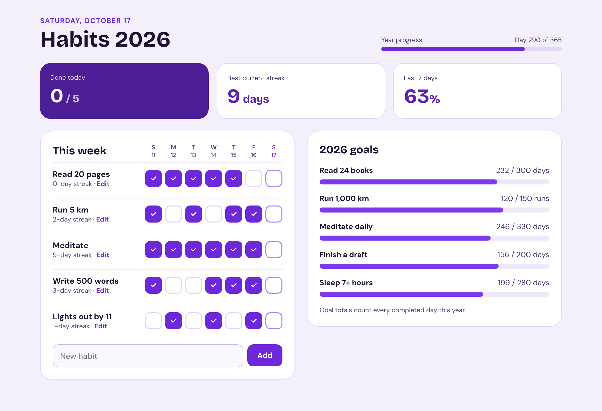
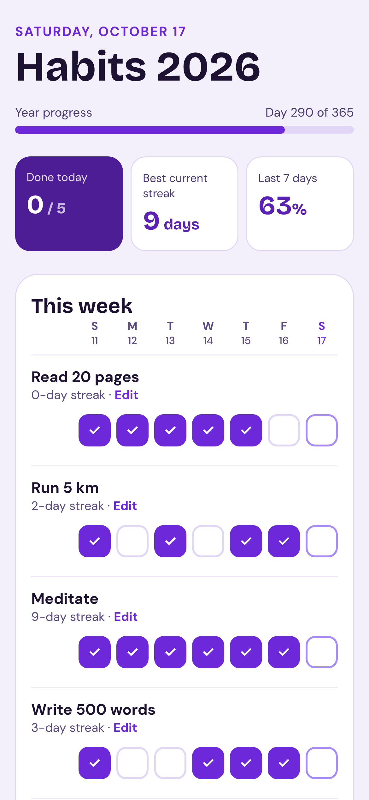
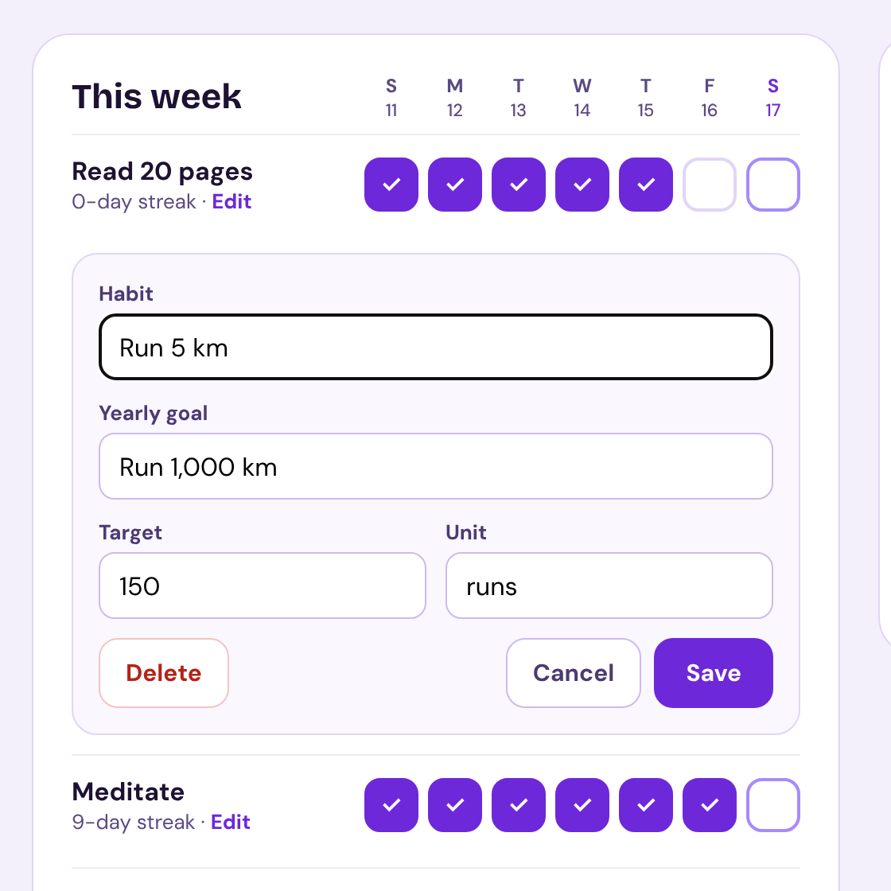

# Habit Tracker Template

A clean, purple habit tracker for yearly goals. Tick off habits each day, watch your streaks grow, and see every goal fill up across the year. Built with React, TypeScript and Vite. No backend, no account, no monthly costs.



## Features

- **Daily check-off** for the last 7 days, with today highlighted
- **Streaks** for every habit, plus your best current streak
- **Yearly goals** with a progress bar per habit (for example "Read 24 books — 232 / 300 days")
- **Today, streak and 7-day stats** at a glance
- **Year progress** bar that follows the current year automatically, leap years included
- **Add, rename, edit goals and delete** habits
- **Saves automatically** in the browser, so nothing is lost on reload
- **Phone-friendly** layout that can be added to the home screen like an app
- **Demo mode**: add `?demo` to the address to show sample habits and history

| Phone | Editing a habit |
| --- | --- |
|  |  |

## Getting started

You need [Node.js](https://nodejs.org) 18 or newer.

```bash
npm install
npm run dev
```

Open the address it prints (usually http://localhost:5173).

## Customise it

| What | Where |
| --- | --- |
| App name ("Habits") | `src/config.ts` → `APP_NAME` |
| Default goal for new habits | `src/config.ts` → `DEFAULT_TARGET`, `DEFAULT_UNIT` |
| Colours | `src/styles.css` → the variables at the top under `:root` |
| Fonts | `src/styles.css` → `--display` and `--body`, plus the Google Fonts link in `index.html` |
| Browser tab icon | `public/favicon.svg` |
| Page description and theme colour | `index.html` |
| Sample habits for demo mode | `src/habits.ts` → `SAMPLE_HABITS` |

**Changing the colour:** the accent is the `--violet-*` scale. Replace those five values with the matching shades of another colour (Tailwind's colour palette is a handy source; for example emerald 950/800/700/600/400). Then adjust `--bg`, `--line`, `--line-soft`, `--input-border` and `--input-bg` to pale tints of the same colour.

If you build more than one app from this template, give each its own `STORAGE_KEY` in `src/config.ts` so their saved data stays separate.

## Put it online (free)

**Vercel**
1. Push the project to a GitHub repository.
2. Sign in at [vercel.com](https://vercel.com) with GitHub, click **Add New… → Project**, and import the repository.
3. Vercel detects Vite automatically. Click **Deploy**.

**Netlify** works the same way: build command `npm run build`, publish directory `dist`.

Every push to your main branch then updates the live site.

## Good to know

- Data is saved in the visitor's browser (`localStorage`). Each browser or device keeps its own list, and clearing site data erases it. There is no login or sync.
- The app has no tracking, analytics or external services apart from Google Fonts.

## Project structure

```
index.html          Page shell, fonts, favicon
public/favicon.svg  Tab icon
src/config.ts       Name and defaults to customise
src/App.tsx         The page and the habit editor
src/habits.ts       Dates, streaks, goal totals, saving and demo data
src/styles.css      Theme variables and all styles
```

## Scripts

| Command | What it does |
| --- | --- |
| `npm run dev` | Start the development server |
| `npm run build` | Type-check and build to `dist/` |
| `npm run preview` | Serve the built `dist/` locally |

## License

See [LICENSE](LICENSE).
